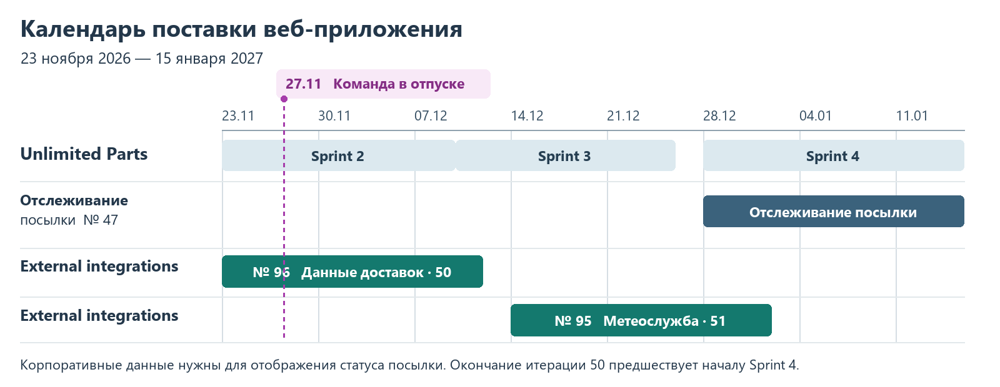

# Поставка Веб-приложения

[Календарь открытых работ](https://github.com/orgs/monin-1-lab/projects/3/views/1) · [Полный план](https://github.com/orgs/monin-1-lab/projects/3/views/2) · [Итерации репозитория](https://github.com/monin-1-lab/Unlimited-Parts/milestones)

Команда Unlimited Parts планирует функции интернет-магазина, а External integrations отвечает за внешние источники данных. В календарь включены истории и отдельная веха отпуска.

## Календарь команд

| Команда | Период | Начало | Окончание |
| --- | --- | --- | --- |
| Unlimited Parts | Sprint 2 | 23.11.2026 | 09.12.2026 |
| Unlimited Parts | Sprint 3 | 10.12.2026 | 25.12.2026 |
| Unlimited Parts | Sprint 4 | 28.12.2026 | 15.01.2027 |
| External integrations | Итерация 50 | 23.11.2026 | 11.12.2026 |
| External integrations | Итерация 51 | 14.12.2026 | 01.01.2027 |

Пурпурная веха [#97 Команда в отпуске](https://github.com/monin-1-lab/Unlimited-Parts/issues/97) приходится на последнюю пятницу ноября — 27.11.2026. Внешние итерации заканчиваются в третью пятницу от начала каждой итерации.

## Изменение очерёдности поставки

| История | Первоначально | После согласования |
| --- | --- | --- |
| [#96 Интеграция с корпоративными данными доставок](https://github.com/monin-1-lab/Unlimited-Parts/issues/96) | Итерация 51 | Итерация 50 |
| [#95 Интеграция с метеорологической службой](https://github.com/monin-1-lab/Unlimited-Parts/issues/95) | Итерация 50 | Итерация 51 |
| [#47 Отслеживание статуса посылки](https://github.com/monin-1-lab/Unlimited-Parts/issues/47) | Sprint 1 | Sprint 4 |

История отслеживания посылки использует данные корпоративной службы доставки. В GitHub Issues задана связь «blocked by». Интеграция запланирована до 11 декабря, а Sprint 4 начинается 28 декабря. Плановые интервалы зависимых работ больше не пересекаются.

В представлении открытых работ действует фильтр по состоянию карточки. История отслеживания посылки сохранила исходный статус Closed и видна в полном плане.
