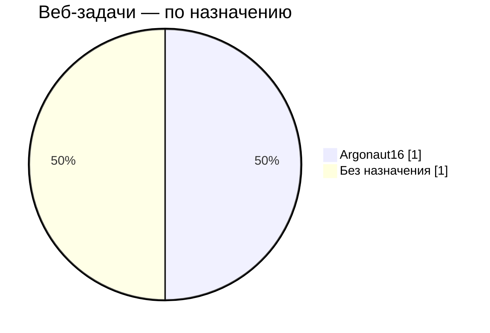

# Обучение продукту

Панель команды **PUL-Web** · Sprint 2 · 23 ноября — 9 декабря 2026 г.

[Канбан команды](https://github.com/orgs/monin-1-lab/projects/2/views/1) · [Веб-задачи](https://github.com/orgs/monin-1-lab/projects/2/views/2) · [Планирование Sprint 2](sprint-2.md)

## Обзор спринта

Оценка Effort отражает относительный объём пользовательских историй. Часы ниже относятся к оставшейся работе по задачам.

[Диаграмма Effort по стадиям](https://github.com/orgs/monin-1-lab/projects/2/insights/2)

| Стадия истории | Effort |
| --- | ---: |
| Approved | 3 |
| QA | 3 |
| **Всего** | **6** |

## Ёмкость спринта

График разработки — 1 ч в рабочий день, понедельник–пятница. В учебном календаре с 30 ноября по 4 декабря отведено пять рабочих дней отсутствия. Из 13 рабочих дней доступны 8.

| Доступно | Осталось по задачам | Перегрузка |
| ---: | ---: | ---: |
| 8 ч | 11 ч | 3 ч |

[Оставшаяся работа по исполнителям](https://github.com/orgs/monin-1-lab/projects/2/insights/3)

При первом планировании разработка страницы занимала 5 ч, проектирование запроса — 3 ч. После пересмотра оценка страницы выросла до 8 ч. Обе задачи включены в Sprint 2.

## Веб-задачи — по назначению

[Общий запрос в Issues](https://github.com/monin-1-lab/Unlimited-Parts/issues?q=is%3Aissue%20label%3A%22area%3A%20PUL-Web%22%20label%3A%22type%3A%20Task%22) · [Сохранённое представление](https://github.com/orgs/monin-1-lab/projects/2/views/2) · [Диаграмма по исполнителям](https://github.com/orgs/monin-1-lab/projects/2/insights/1)

| Задача | Исполнитель | Активность | Остаток |
| --- | --- | --- | ---: |
| [#94 Оптимизация запроса к данным для последних учебников](https://github.com/monin-1-lab/Unlimited-Parts/issues/94) | Без назначения | Дизайн | 3 ч |
| [#93 Добавить страницу для самых последних учебников](https://github.com/monin-1-lab/Unlimited-Parts/issues/93) | Argonaut16 | Разработка | 8 ч |

## Канбан историй

| Дорожка | New | Approved | Committed | Утверждено QA · Doing | Утверждено QA · Done | Done |
| --- | --- | --- | --- | --- | --- | --- |
| Ускоренная | — | — | — | [#91 Как клиент, я хочу видеть недавно просмотренные учебники](https://github.com/monin-1-lab/Unlimited-Parts/issues/91) | — | — |
| Обычная | — | [#90 Как клиент, я хочу просмотреть новые учебники](https://github.com/monin-1-lab/Unlimited-Parts/issues/90) | — | [#92 Как клиент, я хочу запросить новые учебные материалы](https://github.com/monin-1-lab/Unlimited-Parts/issues/92) | — | — |

**Незавершённая работа в QA:** 2 из 1. Лимит превышен.

**Критерий завершения QA.** Все тесты истории проходят. После проверки результата карточку перемещают из Doing в Done. В первую очередь команда берёт карточку с ускоренной дорожки.

## Бэклог команды

[Эпик и все дочерние уровни](https://github.com/monin-1-lab/Unlimited-Parts/issues/88) · [Рабочие элементы команды](https://github.com/monin-1-lab/Unlimited-Parts/issues?q=is%3Aissue%20label%3A%22area%3A%20PUL-Web%22) · [Календарь спринтов](https://github.com/monin-1-lab/Unlimited-Parts/milestones).

| Итерация | Период |
| --- | --- |
| Sprint 1 | 02.11–20.11.2026 |
| Sprint 2 | 23.11–09.12.2026 |
| Sprint 3 | 10.12–25.12.2026 |

## Мой Scrum

Иерархия работ включает эпик, функциональность, пользовательскую историю и задачу. В каждой истории поле Ticket ID группы PartsUnlimitedGroup хранит внешний номер обращения. При создании истории используется [форма бэклога](https://github.com/monin-1-lab/Unlimited-Parts/issues/new?template=pul-backlog.yml).
